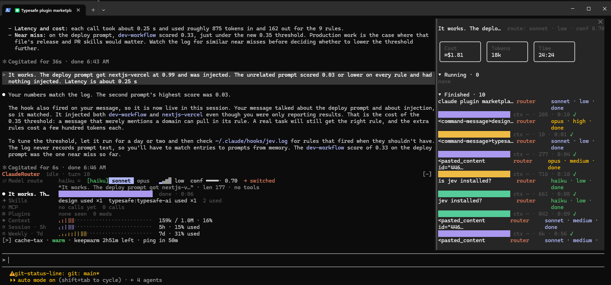

# ClaudeRouter

A Claude Code mod that picks the **model and effort for each request**, and keeps a live band above your prompt showing what the session is doing.



## What it does

- **Routes every request** to `haiku`, `sonnet` or `opus` with a reasoning effort (`low` → `xhigh`) and a confidence score. Routing is local keyword/length/tool heuristics: no model is called to decide. A small hysteresis stops it flip-flopping between tiers.
- **Live band above the prompt**: current route, running agents, skills used, MCP calls, plugins seen, context window, and 5h / 7d plan usage.
- **`/clauderouter` pane**: cost, tokens and elapsed time cards, plus the running and finished subagents with the model and effort each one got.
- **Jev as the router (optional)**: let [Jev](https://typesafe.ai) (TypeSafe System One) pick the tier instead of the keyword rules. Falls back to the rules on any error or timeout.
- **Keep the cache warm (optional)**: pings the prompt cache every 50 minutes while you are idle, so a break does not cost a full re-write.
- **Pixel mascots** per subagent role: scout (Explore), planner (Plan), researcher, builder.

## Requirements

- A Claude Code build that supports mods (plugins that ship `hooks/*.ts` modules and a `types` entry).
- Git, to clone the repo.

## Install

1. Clone the repo anywhere on your machine:

   ```bash
   git clone https://github.com/visualife/ClaudeRouter
   ```

2. In Claude Code, add the clone as a local marketplace and install the plugin:

   ```
   /plugin marketplace add ./ClaudeRouter
   /plugin install agent-ClaudeRouter@router-mods
   ```

   Use the full path to the clone if it is not in the directory you launched Claude Code from.

3. Reload plugins (`/reload-plugins`) or restart Claude Code. The band appears above the prompt.

## Usage

- **Band**: shows automatically. It updates on every prompt with the picked model, effort and confidence, and tells you when it switched model.
- **Pane**: type `/clauderouter` to open it. Press `Esc` to close.
- **Subagents**: each one appears in the pane's *Running* and *Finished* lists with its own model and effort.

## Options

Set them from the prompt; they persist across reloads.

| Command | Effect |
|---|---|
| `/clauderouter engine jev` | Jev picks haiku / sonnet / opus. Needs `TYPESAFE_API_KEY` in the environment. |
| `/clauderouter engine rules` | Local keyword rules (default). |
| `/clauderouter warm 2h` | Keep the prompt cache warm for 2h (default 2h, max 6h). |
| `/clauderouter warm off` | Stop. |
| `/clauderouter status` | Show the current options. |

**Jev**: it only chooses the tier; Claude still does the work. Each routed request sends the prompt text (first 4000 characters) to `api.typesafe.ai` and costs one small Jev call (about 0.3 s). A pick made by Jev shows `jev ·` at the start of the band's second line. With no key, an error or a 2.5 s timeout, the rules decide, so nothing blocks.

**Keep warm**: each ping is a short model call on the existing conversation (cache reads, cheap). It only runs while the window is open and no turn is running, and it ends the window if a ping fails, since the cache is then probably gone. Switching model tiers loses the cache of the previous tier, which is what this is for. If you already run the `cache-tax` mod's `/keepwarm`, use one of the two, not both.

## Update / uninstall

```bash
git -C ClaudeRouter pull
```

```
/plugin uninstall agent-ClaudeRouter@router-mods
/plugin marketplace remove router-mods
```

## Tuning

Routing lives in `hooks/route.ts`: edit the `HEAVY`, `MID` and `LIGHT` keyword lists, or `HYSTERESIS`, to change how eagerly it moves between tiers.

## Layout

| Path | Role |
|---|---|
| `hooks/register.ts` | Hook and command registration, state, `/clauderouter` |
| `hooks/route.ts` | Model and effort heuristics |
| `hooks/band.ts` | The band above the prompt |
| `hooks/pane.ts` | The `/clauderouter` pane |
| `hooks/pixel.ts`, `format.ts`, `lists.ts` | Sprites, formatting, list rows |
| `tests/router.test.ts` | Routing tests |

## Notes

- Built against the Claude Code mod API; type stubs are generated into `.claude-plugin/types/` (git-ignored).
- Routing is a heuristic. Check the log of what it picked before trusting it on a real task.
