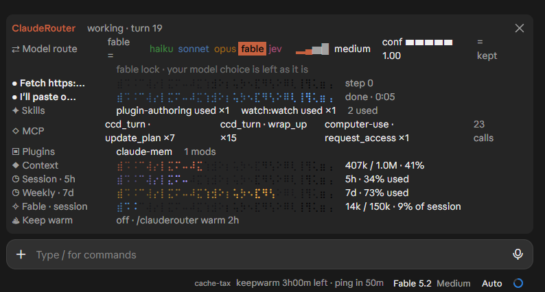
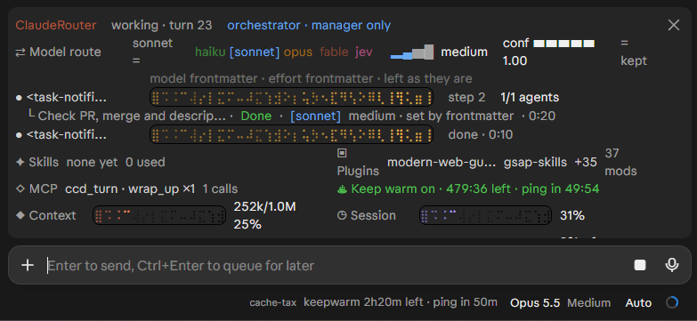

# ClaudeRouter

A Claude Code mod that picks the **model and effort for each request**, and keeps a live band above your prompt showing what the session is doing.



## What it does

- **Routes every request** to `haiku`, `sonnet` or `opus`, with a reasoning effort from `low` to `xhigh` and a confidence score. Routing is local keyword, length and tool heuristics: no model is called to decide (Jev, below, is the optional exception). A hysteresis margin stops it flip-flopping between tiers. `max` is never picked: it appears only when an agent file or an Agent call sets it.
- **Fable is picked by the rules for flagship creative work only.** Flagship creative work (brand identity, naming, taglines, art direction, campaign concepts) goes to Fable `high` by default; `/cr-creative opus` sends it to Opus `xhigh` instead. Nothing else is routed to Fable; you can still choose it yourself (`/cr-pin fable`, a `@fable` prefix). A session on a locked model, Fable by default, is passed through untouched: the router keeps the model and effort it arrived with (see **Model locks**).
- **Live band above the prompt**: the route with the current model shown as a `[sonnet]` chip, plain grey text, then the running and finished agents, skills used, MCP calls, plugins seen, context, 5h / 7d usage and the keep-warm clock. `/cr-band route` shrinks it to the task bar and the route.
- **`/cr` pane**: cards for cost, tokens, time, Deck cost, skills, MCP, plugins, context, usage and keep-warm, then the running and finished rows. Each sub-agent row shows its type and task, `model · effort · state`, who set them (`set by`), its tokens in, cached and out, and its cost. Each row bar is the share of its prompt's tokens spent by sub-agents (a prompt row) or the agent's share of its prompt (an agent row), capped at 20 columns.
- **Jev as the router (optional)**: let [Jev](https://typesafe.ai) (TypeSafe System One) pick the tier instead of the keyword rules. Falls back to the rules on any error or timeout.
- **Keep the cache warm (automatic)**: your first request in a session arms a 2-hour window, and each later request rolls it forward, so a break does not cost a full re-write. While you are idle it pings the prompt cache every 4 minutes (inside the default 5-minute cache; set `CR_WARM_EVERY_MIN`, e.g. 50 for a 1-hour cache). `/cr-warm 8h` (short `/cr-kw`) sets a window by hand, up to 8 hours; `/cr-warm off` or `CR_WARM_AUTO=0` turns the automatic part off.
- **Orchestrator mode (v0.5.0)**: one strong session manages and delegates, sub-agents keep the model and effort their file or call set, and a manager guard refuses the main thread's file reads and writes and shell commands. See [Orchestrator mode](#orchestrator-mode-v050).
- **Session log, `/cr-log`, `/cr-review`**: each session writes a `.jsonl` and a `.md` log under `~/.claude/cr-logs/<project>/`; `/cr-log` shows the table, `/cr-review [n]` has one Sonnet agent propose at most five edits from the last n logs. See [Manager mode and the session log](#manager-mode-and-the-session-log-v05).
- **Costs and prices**: `/cr-deck` prints the deck with exact figures, `/cr-prices` reloads the price table (`prices.json`, shipped empty, overridden by `~/.claude/clauderouter-prices.json`). A row with no price shows "prices missing"; nothing is estimated.
- **Pixel mascots** per subagent role: scout (Explore), planner (Plan), researcher and builder.

## Orchestrator mode (v0.5.0)



For a session where one strong model (Fable, say) splits the work and hands each part to a sub-agent with its own model and effort. On by default: every new session starts with the rules from `~/.claude/orchestrator.md` loaded (if that file is missing, the mode falls back to off with a notice). With `/cr-orchestrator off` the main model is routed exactly as before.

**Who chooses a sub-agent's model and effort.** The router chooses only what nobody else did. In order: an environment override, the Agent call's own `model` / `effort` (the orchestrator), the agent file's `model` / `effort` frontmatter, then the router. A choice made upstream is passed through unchanged, on the spawn and on every request after it. Each part is decided separately: a file that sets the model and no effort gets the router's effort for that model (held to medium unless the agent plans). An agent whose file the router cannot read, and a fork, are left to the engine rather than routed over a choice it cannot see. The router finds agent files in `.claude/agents/` (the project and its parents), `~/.claude/agents/` and a plugin's `agents/`.

**`/cr-orchestrator on` (short: `/cr-orch on`).** The session's own model is left as chosen and is never rerouted (a pin or an `@model` prefix, which you typed, still applies). A sub-agent that nothing sets is routed by the usual rules instead of inheriting a locked parent's model.

**The deck.** In the `/cr` pane every sub-agent row shows its type and task, model, effort, who set them (`frontmatter`, `orchestrator`, `router`, `env`, or `default` for a part the router left to the engine) and its tokens: prompt tokens billed fresh (input plus cache writes), prompt tokens the cache served, and tokens written. The band's agent lines show model, effort and who set them.

**Environment overrides.** `CLAUDE_CODE_SUBAGENT_MODEL_FORCE` (with `CLAUDE_CODE_SUBAGENT_MODEL`) and `CLAUDE_CODE_EFFORT_LEVEL` override every choice above, the orchestrator's included. If either is set, a warning is toasted at session start and stays in the pane and the band.

**Cost.** Fill in `prices.json` (shipped empty: USD per million tokens per model, input, output, cache write, cache read) or a copy at `~/.claude/clauderouter-prices.json`, which overrides it field by field. The pane shows a cost per row and a "Deck cost" card, `/cr-deck` prints them as text, and `/cr-prices` reloads the table. With a price missing the deck says "prices missing"; nothing is ever estimated.

Per-invocation `effort` on an Agent call needs Claude Code v2.1.292 or later.

## Manager mode and the session log (v0.5)

`/cr-orchestrator on` makes the session a manager: `~/.claude/orchestrator.md` is loaded into the main session (when turned on and after a compaction, never into a sub-agent; a missing file is reported, not confirmed), and the main thread's Read, Glob, Grep, Write, Edit, NotebookEdit and Bash calls are refused except on `MAP.md`, `HANDOFF.md`, `CLAUDE.md` and `plans/` inside the session's project folder, plus `~/.claude/orchestrator.md`, `~/.claude/routing/` and `~/.claude/agents/` (reads), and `MAP.md`, `HANDOFF.md`, `CLAUDE.md`, `plans/` and `old-handoff/` inside the project folder, plus the same three `~/.claude` paths (writes). Every path is resolved first (`~`, `..`, `.` and separators), so a `..` cannot climb out of an allowed folder; every other path, `~/.claude/settings.json` included, is refused. If the rules cannot be loaded into the session, the orchestrator goes off for it, with a notice; a resumed conversation that already holds the rules does not get them a second time. A refused call is answered with the agent to hand the work to: Read, Glob and Grep point to `scout`, Write, Edit, MultiEdit and NotebookEdit to `coder`, Bash to `test-runner`; the message also lists `architect` (design or contract), `art-copy` (design and copy) and `verifier` (judging). Sub-agents are never guarded. `/cr-orchestrator off` lifts the block at once; `/cr-orchestrator hands on` lifts it for an emergency, keeps the rules, and shows amber. `/cr-status` shows the mode and whether the rules are loaded. The deck counts guard blocks and sets the main thread's tokens and cost against the sub-agents'. The mode is per session: it is not remembered for the next one. The router never changes the session's own model: to have a Fable manager, start the session on Fable.

**Roster the guard and rules expect** in `~/.claude/agents/` (your files, not shipped here): `scout` (reads), `coder` (changes), `architect` (design, contracts), `art-copy` (design and copy), `test-runner` (test, lint and build runs), `verifier` and `integrator`. `verifier` runs on Sonnet at high effort, 20 turns, edits nothing, and ends its report with PASS / FAIL / NOT CHECKED lines. `integrator` runs on Sonnet at medium effort and does the MCP work on Supabase, n8n, Vercel, Stripe and Shopify; it reads and inspects by default and changes a system only when the brief says so.

**Session log.** The hooks (no model) write `~/.claude/cr-logs/<project>/<date>-<hhmm>-<session>.jsonl`, one line per event (task, agent launch, skill, MCP, agent end, guard block, follow-up, verifier verdict, main turn, Workflow call (`workflow`: its name only), keep-warm ping (`warm`: the time and the minutes left), session start and end), and a readable `.md` of the same name at session end. Lines are built from named fields only: a prompt is cut to 120 characters, and no file content, tool payload, brief body or environment value is written. A block line for a refused Bash call keeps only the program and, for a known subcommand tool such as `git`, `gh` or `npm`, its plain lowercase subcommand (`git push`, `npm run`): no other argument, flag, URL or value. `/cr-log` shows the current session as a table, `/cr-log last` the previous one. A verifier's verdict is counted from its hand-back report: any FAIL line fails it, all PASS lines pass it, anything else is not checked. The skills of an agent are read from the `Skills:` line of its brief. `/cr-review [n]` (default 10) has one Sonnet agent at medium effort, with Read and Grep only, read the last n logs of the project and answer with per-agent figures and at most five proposed edits; its answer is written to `reviews/<date>.md` and nothing is changed. The agent's paths are limited by its brief, not enforced: a plugin's own sub-agent steps past the plugin's tool hook.

## Cost guards (v0.4)

Applied on every model request, after the router (or Jev) has picked. Defaults protect your plan; change them with `/cr`.

| Guard | Default | Effect |
|---|---|---|
| Effort ceiling | `high` | `xhigh` is never picked automatically. `/cr-cap medium` to lower it. |
| Opus plans, Sonnet executes | first 2 requests | After that, or once the turn writes files / runs 6+ tools, the turn moves to Sonnet (medium). |
| Long spec | > 1200 chars | Opus never runs above medium on it. |
| Subagents | not Opus | Only `Plan` subagents may use Opus; all others capped at medium. |
| Turn budget | $3 per turn | Over it: Sonnet medium. Over 2×: Sonnet low. `/cr-budget 5` or `off`. |
| Context cap | 150k tokens | Over it: Sonnet medium. Over 1.5×: Sonnet low. `/cr-ctx 200k` or `off`. |
| Haiku and big contexts | 100k tokens | Above it the main thread never moves to Haiku: a light request stays on Sonnet at low effort. Subagents are not concerned. |
| Your choice wins | none | `/cr-pin sonnet medium` applies from the **next request, even mid-turn**. `pin auto` releases it. Or prefix one prompt: `@sonnet:med build the app` / `@opus:high ...`. |
| Model locks | `fable` | A session on a locked model is left alone, subagents included. See **Model locks**. |
| Creative work stays strong | on | Copywriting, art direction and brand work get their own tiers, by case (see **Creative work**). They keep their model for the whole turn: no plan/execute split, no long-prompt cap, and their own effort ceiling (`xhigh`). Over the budget or context cap the model drops to Sonnet, but the effort stays high. Creative subagents run on Sonnet at high effort. Your pin and locks still win. |

The band's second line shows `guard ...` with the reason whenever a limit changed the pick, and is hidden otherwise. Budget uses the session cost the engine reports (API-equivalent USD).

**Claude Code mode.** `/cr-mode claude` turns routing off: no model switch, no effort change, no creative floor, no locks, and the band and pane read `route: claude code`; Claude Code keeps its own model and effort. In this mode the budget and context-cap guards are skipped too, since they only act on the router's pick. Tasks, tokens, agents, the deck, costs, the manager guard (orchestrator mode), the session logs and keep-warm run as before. `/cr-mode router` turns routing back on (default), and orchestrator mode works in both.

## Agent roster (v0.4.5)

The plugin ships three subagents in `agents/`: `planner` (Opus, read-only, returns a plan), `implementer` (Sonnet) and `reviewer` (Sonnet, one pass with a checklist). A subagent type named `Plan`, `planner` or `architect` (also as `agent-ClaudeRouter:planner`) is the only kind that may run on Opus, at `xhigh`; every other subagent stays on Sonnet or Haiku. For test, lint and build runs, keep a Haiku `test-runner` agent of your own: the router already sends runner-named types to Haiku.

## Routing fixes (v0.4.4)

- **A nudge carries on.** A prompt under 60 characters with no keyword ("yes go ahead", "oui vas-y", "continue") keeps the model and effort the previous turn ended on. It used to score as a short light request, so the turn that ran an approved plan started on Haiku at low effort.
- **French prompts are scored.** The heavy / mid / light lists have French forms (`planifie`, `débogue`, `corrige`, `ajoute`, `mets à jour`, `liste`, `où`...). Before, a French code prompt matched nothing and ran on Sonnet at low effort.
- **Sonnet runs at medium**, its stock effort. Low is kept for a prompt that reads as a lookup and nothing else.
- **Everyday words count for half when alone**: `design`, `system`, `why`, `across`, `race`, `performance`, `optimize`. "update the design system tokens in the css file" stays on Sonnet; "debug why the token check fails" is still Opus.
- **Runner subagents go to Haiku.** A subagent type with `runner`, `lint` / `linter` or `format` / `formatter` as a name part (`test-runner`) outweighs the "test" and "build" in its own brief.
- **No Haiku above 100k tokens on the main thread.** Haiku 5.5 bills a prompt over 100k tokens at five times its base rates, and a model switch re-reads the whole context uncached. The band shows `guard haiku>100k`.
- **Jev is asked once per turn** per thread (the main conversation, each subagent), not before every model request, and not at all about a prompt that only carries on. A failed call is not retried until the next turn.
- The context-cap warning names the cheaper fix: `/compact`, or `/clear` between tasks.
- "affiche les fichiers" (the French verb) is no longer read as a poster brief.

## Creative work (v0.4.3)

Copywriting, art direction and brand work are judged on taste and voice, not speed, so the router gives them a stronger model and more effort than code of the same length. The case decides how much:

| Case | Examples (EN / FR) | Model / effort |
|---|---|---|
| **Flagship**: work a brand lives with | brand identity, naming, tagline, slogan, manifesto, value proposition, art direction / direction artistique, creative brief, moodboard, key visual, campaign concept, logo concept, color palette, font pairing, video script, storyboard, design critique | **Opus `xhigh`**, or **Fable `high`** with `/cr-creative fable` |
| **Craft**: everyday copy and visual briefs | landing page, product description / fiche produit, newsletter, subject lines, captions, social posts, blog post, press release, image prompts (Midjourney, Magnific, Flux), photo brief, poster, flyer | **Opus `high`** |
| **Bulk**: volume or adaptation | a whole catalogue or CSV of product sheets, translations / traductions, meta descriptions, alt text, SEO titles | **Sonnet `high`** |

- Volume turns craft into bulk. It turns flagship into craft, not bulk: a translated manifesto still needs care.
- Creative turns use `creativeCap` (default `xhigh`) as their ceiling instead of `cap`. `/cr-creative cap high` lowers it.
- Fable is the default for flagship work: it goes to Fable 5.2 at `high` (Anthropic's recommended default for it); `/cr-creative opus` sends it to Opus `xhigh` instead. Craft and bulk stay where they are. Each flagship turn then draws on your weekly Fable allowance. A session the router moved to Fable is not frozen there by the Fable lock: the lock only holds a model *you* chose.
- `/cr-creative off` routes creative prompts like any other.
- Bare "copy", "design", "script", "naming" and "positionnement" are not creative signals on purpose: "copy the file", "naming conventions", "a bash script" and CSS positioning stay code.
- When the guard kept the model for a creative turn, the band's second line shows `guard flagship: strong` (or `craft`, `bulk`). The keyword that made the turn creative (`kw:creative`, `kw:copy`) is no longer echoed on the band.

## Model locks (v0.4.1)

A lock tells the router to leave a model alone. When the session runs on a locked model, every request keeps the model and effort it arrived with: no rerouting, no budget or context downgrade. The band shows `<model> lock`. Fable is locked by default; the router never picks Fable by itself.

- `/cr-lock opus` locks a model, `/cr-unlock opus` releases it. `lock all` / `lock none` for every model. `/cr-status` lists what is locked.
- **Subagents stay locked too.** A subagent spawned from a locked session that names no model inherits the session's model and keeps it on every request, until you unlock. A subagent whose Agent call names a model always keeps that model.
- A model id the router does not know is never rewritten (it used to become Sonnet).
- A pin (`/cr-pin <model>`) or an `@model` prompt prefix still wins over a lock.
- `/cr-lock fable` and `fable auto` from 0.4.1 still work; they mean `lock fable` and `unlock fable`.
- **What went wrong before:** the router only knew haiku, sonnet and opus. A Fable id matched none of them, so each request, main thread and subagents alike, was rewritten to `claude-sonnet-5-5` or `claude-haiku-5-5`, and the band said "switched". Ids are now looked up in `MODEL_IDS` instead of swapping a word in the running id.

## Dashboard pane (v0.4.2)

The full dashboard is the `/cr` pane: cost, tokens and time, skills, MCP, plugins, context, 5h / 7d usage, the **Keep warm** clock (time left in the window and the countdown to the next ping), and the running and finished agents. It opens at session start, 24 rows tall. Drag or resize it with the engine's pane controls, or dock it beside the chat on a wide terminal, so it does not cover the conversation. The band above the prompt shows every row again (route, agents, skills, MCP, plugins, context, 5h / 7d, keep-warm). Claude Code places and sizes that band, so a mod cannot make it draggable; only the pane drags. To keep the chat clear, `/cr-band route` shrinks the band to the **task bar** (● task name, a bar with a `Tasks 2/4` pill, the percent, a small crab and the agent count) over the model route line, and `/cr-band full` brings every row back. Claude Code's own collapse (`[-]`, ctrl+x ctrl+a) also works on it.

**Bars show real values and never move.** Every bar is one text line tall, like the Savvy Progress reference, and holds a 4-row dot matrix: each cell is a braille character (a 2 x 4 grid of dots) with a fixed random subset lit, the same texture on every bar. The filled part shows it in the accent, the part still ahead shows the same dots very dim, so a fill reads as the texture being revealed. Each bar has a 1px black contour (a single-line border). The terminal draws it as a one-row Raster, the desktop as Text runs. The fill is the measured share: context, 5h and 7d are their percent; a task is its finished subagents over all of them; a pane row is the share of its prompt's tokens spent by sub-agents (see below), on a bar of 6 to 20 columns depending on the pane width. No reading yet means an all-dim bar. Opacity is eased, not linear: the fill is dim at its tail and brightens toward the leading edge on a power curve, and the track ahead fades out on a smoothstep. The `Tasks 2/4` capsule sits at the edge of the fill (left at 0%, moving right as it grows). The Jev chip is pink. The small crab beside the percent is the reference crab (eyes, side arms, four legs): a Raster in the terminal, one line of five braille characters on the desktop, the height of the text beside it.

**Row bars** show the share of the prompt's tokens spent by sub-agents: a prompt row is its agents' tokens over all the prompt's tokens (0 with no agent), an agent row is its own share of its prompt.

**Fable usage bar.** The band and the pane have a `Fable · session` row: the share of this session's tokens that ran on Fable. Claude Code reports only the 5h and 7d windows (and a gateway spend limit), not how much of the weekly limit went to Fable, so the plan's 50% Fable cap cannot be read from here. If the engine ever reports a window that names Fable, the row shows that reading as `Fable · plan` instead.

## Models (v0.4.2)

| Family | Id the router uses | Auto-picked | Notes |
|---|---|---|---|
| `haiku` | `claude-haiku-5-5` | yes | Light reads, searches, subagents of type Explore. |
| `sonnet` | `claude-sonnet-5-5` | yes | Default for building and executing. |
| `opus` | `claude-opus-5-5` | yes | Planning, craft copy (`high`) and, with `creative opus`, flagship creative work (`xhigh`). |
| `fable` | `claude-fable-5-2` | flagship creative work (default) | Locked by default. A session already on Fable 5.1 or 5 keeps its own id; `claude-fable-5-2` is only used when you pin or switch into Fable. |

**Fable and your plan** (per [Anthropic's help page](https://support.claude.com/en/articles/15424964-claude-fable-models-on-your-plan), checked 2026-11-09): Fable 5, 5.1 and 5.2 are on all paid plans. Max, Ultra and premium Team/Enterprise seats include Fable in the plan, up to 50% of the weekly limit; Pro and standard seats run Fable on usage credits. The page gives no end date for the plan inclusion; the one dated promotion (Fable 5 only) ended 2026-07-19. Claude Code minimums: Fable 5.2 needs 2.1.321, 5.1 needs 2.1.255. That is why Fable stays locked and is never picked automatically: it eats the weekly limit faster than the other models.

## Claude desktop

The mod is surface-aware: the band and pane already draw with plain `Text` bars on `desktop` (no Raster), and the tests cover both surfaces. Claude desktop's Code tab runs the same Claude Code engine, so install it there with the same two commands:

```
/plugin marketplace add C:\Users\studi.REAL\Documents\GitHub\ClaudeRouter
/plugin install agent-ClaudeRouter@router-mods
/reload-plugins
```

Install at user scope so the CLI and the desktop Code tab share it. Chat and Cowork tabs do not run mods.

## Requirements

- A Claude Code build that supports mods (plugins that ship `hooks/*.ts` modules and a `types` entry).
- Git, to clone the repo.

## Install

1. Clone the repo anywhere on your machine:

   ```bash
   git clone https://github.com/visualife/ClaudeRouter
   ```

2. In Claude Code, add the clone as a local marketplace and install the plugin:

   ```
   /plugin marketplace add ./ClaudeRouter
   /plugin install agent-ClaudeRouter@router-mods
   ```

   Use the full path to the clone if it is not in the directory you launched Claude Code from.

3. Reload plugins (`/reload-plugins`) or restart Claude Code. The band appears above the prompt.

## Usage

- **Band**: shows automatically. It updates on every prompt with the picked model, effort and confidence, and tells you when it switched model.
- **Pane**: type `/cr` to open it. Press `Esc` to close.
- **Subagents**: each one appears in the pane's *Running* and *Finished* lists with its own model and effort.

## Options

Set them from the prompt; they persist across reloads.

| Command | Effect |
|---|---|
| `/cr-engine jev` | Jev picks haiku / sonnet / opus. Needs `TYPESAFE_API_KEY` in the environment. |
| `/cr-engine rules` | Local keyword rules (default). |
| `/cr-warm 2h` (short: `/cr-kw 2h`) | Set the keep-warm window by hand: 2h (default 2h, max 8h). A manual window keeps its own deadline; requests never shorten, extend or replace it. Without this command the first request arms a 2h window by itself (see Keep warm below). Ping every 4 min by default; `CR_WARM_EVERY_MIN` changes it (50 for a 1-hour cache). |
| `/cr-warm off` | Stop, and do not auto-arm again for the rest of the session. |
| `/cr-pin <model> [effort]` / `pin auto` | Force a model (and effort), effective next request. |
| `/cr-lock <model\|all\|none>` / `unlock <model\|all>` | Leave a model alone (no rerouting, no caps), subagents included. Fable is locked by default. |
| `/cr-cap <effort>` | Highest effort the router may pick. |
| `/cr-budget <usd\|off>` | Per-turn spend limit. |
| `/cr-ctx <150k\|off>` | Context size limit. |
| `/cr-band <full\|route\|off>` | Band above the prompt: every row, only the task bar and the model route, or closed. The band also has a close control (✕ in the terminal, the native close mark on the desktop) that sets `off`; `band full` brings it back. The pane is separate and stays open. |
| `/cr-creative <opus\|fable\|off>` | Where flagship creative work goes: Fable `high` (default), Opus `xhigh`, or no creative routing. |
| `/cr-creative cap <effort>` | Highest effort creative work may run at (default `xhigh`). |
| `/cr-orchestrator <on\|off>` (short: `/cr-orch`) | Orchestrator mode: the session model is never rerouted, sub-agents keep the model and effort their file or call set. On by default. |
| `/cr-orchestrator hands on` | Lifts the manager guard (emergency), keeps the rules loaded, band shows amber. |
| `/cr-mode <router\|claude>` | `claude` is Claude Code mode: routing off, Claude Code keeps its own model and effort; tracking, logs, deck, costs, guard and keep-warm go on. `router` turns routing back on (default). |
| `/cr-ultracode <off\|advise>` / `max=N` | Ultracode advice (default `advise`, `max=5`): detect the keyword, route and log Workflow agents, warn when one task launches more than N. It never turns ultracode on. |
| `/cr-deck` | The agent deck as text: model, effort, who set them, tokens and cost per agent. |
| `/cr-prices` | Reload the price table and say which prices are filled in. |
| `/cr-log` / `/cr-log last` | This session's log as a table, or the previous session's. |
| `/cr-review [n]` | One Sonnet agent reads the last n logs (default 10) and proposes at most five edits. |
| `/cr-status` | Show the current options. |

**Ultracode.** Only the person can turn it on: type the `ultracode` keyword in a prompt, or `/effort ultracode`. The mod never turns it on and never approves a Workflow call. Recommended: `/config workflowSizeGuideline=small`. With `/cr-ultracode advise` (default) the mod:
- detects the keyword in a prompt and shows an `ultracode` chip on the route row while that task runs;
- routes Workflow agents like any other sub-agent (Opus and Fable go down to Sonnet unless the script names a model), including when the engine gives no parent model;
- logs each Workflow call (its meta name) and tags the agents it launches with `wf`;
- warns when one task launches more than `max` Workflow agents (default 5).
The manager guard's refusal also names a Workflow as an option once the person opted into ultracode.

**Jev**: it only chooses the tier; Claude still does the work. Each turn sends the prompt text (first 4000 characters) to `api.typesafe.ai` once per thread, the main conversation and each subagent, and costs one small Jev call (about 0.3 s); the following requests of the turn reuse the answer. In the band, `jev` sits beside `haiku sonnet opus` on the Model route row: lit when Jev made the pick, dim when the rules did. Once Jev has been used, a `Jev · context` bar appears: the last call's input tokens against Jev's 64k per-request window, with the call count. A Jev pick shows `jev` on the band's second line (the line is otherwise hidden unless a guard limit applied). With no key, an error or a 2.5 s timeout, the rules decide, so nothing blocks.

**Keep warm**: auto-arm is on by default. The first real main-thread request of a session (not a sub-agent's, not a ping) opens a window of 2 hours when none is open, and logs a `warm` event `armed` with `via:"auto"`. While that auto window is open, each real request moves its deadline to now + 2 hours (never earlier, capped at 8 hours from now); pings do not extend it, so an idle session still closes 2 hours after its last request. A window set with `/cr-warm <dur>` or `/cr-kw` is manual: it keeps its own deadline. Switches: `/cr-warm off` closes the window and stops auto-arm until the session restarts; the environment variable `CR_WARM_AUTO=0` (also `off` or `false`) disables auto-arm entirely, and `/cr-warm 2h` still works by hand. A failed ping closes the window as before; the next real request arms a new one (unless auto-arm is off). Cost: a ping every 4 minutes reads the cached prefix (cache-read price) for the whole window, which adds up over 2 hours; with a 1-hour cache set `CR_WARM_EVERY_MIN=50` to ping far less often. Each ping is a short model call on the existing conversation (cache reads, cheap). The ping must land inside the cache lifetime (5 minutes by default), so the interval is 4 minutes of main-thread idle by default. Override it with the `CR_WARM_EVERY_MIN` environment variable (minutes; invalid or under 1 is ignored, capped at 55); use 50 for a 1-hour cache. `/cr-warm 8h` and the 8h cap only set how long pinging continues, not how often. A ping only runs while the window is open and no turn is running, and it ends the window if a ping fails, since the cache is then probably gone. A turn that failed or was aborted no longer counts as running, and `busy` is cleared after 20 minutes with no step on the main thread. Nothing is skipped silently: when a due ping is not sent, the session log gets a `warm` line with `ok:false` and `skip` (`busy`, `no-request` or `window-closed`), once per reason per idle period. Each sent ping's `warm` line carries `cached` (cache-read tokens), `written` (cache-write tokens), `in`, `out` and `model` (the main thread's last model; never the ping's text), or `usage:"none"` if the fork reported no usage. A `cached` in the 100k range proves the main cache was kept; `cached` near 0 with a large `written` means the fork did not share the main prefix. The fork re-sends the main thread's last request, so it has the same model and effort and takes none of its own. Switching model tiers loses the cache of the previous tier, which is what this is for. If you already run the `cache-tax` mod's `/keepwarm`, use one of the two, not both.

## Update / uninstall

```bash
git -C ClaudeRouter pull
```

```
/plugin uninstall agent-ClaudeRouter@router-mods
/plugin marketplace remove router-mods
```

## Tuning

Routing lives in `hooks/route.ts`: edit the `HEAVY`, `HEAVY_WEAK`, `MID` and `LIGHT` keyword lists (and their `_FR` twins), or `HYSTERESIS`, to change how eagerly it moves between tiers.

When a main-thread Fable request fails on a rate limit that looks like a usage cap (a rate-limit window at 100%, or error details that mention usage, limit or quota), every Fable request (main thread and sub-agents, router or Claude Code mode, lock or not) goes out as Opus with the same effort until the reset time (an hour when none is known), then Fable returns; the band shows `Fable out of usage · Opus until HH:MM` (with `· pin paused` or `· lock paused` when it overrides one) and the log gets a `fallback` line. A plain rate-limit failure triggers nothing the first time; a second one within 10 minutes holds Opus for 15 minutes. The engine's failure signal is not yet confirmed: `probe` log lines (error code, whether details exist and their length, thread, model family, rate-limit windows; never any text) will confirm it. `/cr-fable reset` ends the fallback now, `/cr-fable off` turns it off (`on` brings it back).

## Layout

| Path | Role |
|---|---|
| `hooks/register.ts` | Hook and command registration, state, `/cr` |
| `hooks/route.ts` | Model and effort heuristics |
| `hooks/guard.ts` | Cost guards: effort ceiling, plan/execute split, budget, context cap, pin |
| `hooks/orchestrate.ts` | Orchestrator mode: who set a sub-agent's model and effort, agent-file lookup, environment overrides |
| `hooks/sessionlog.ts` | Session log lines (`.jsonl`, `.md`), verdict counting, the `/cr-review` brief |
| `hooks/band.ts` | The band above the prompt, the model shown as `[sonnet]` |
| `hooks/pane.ts` | The `/cr` pane |
| `hooks/pixel.ts`, `format.ts`, `lists.ts` | Sprites, formatting, list rows |
| `tests/router.test.ts` | Routing tests |
| `tests/copy.test.ts` | Creative cases, floor, guard and `creative` options |
| `tests/log.test.ts` | Session log lines, what is never recorded, verdicts, `/cr-log` |
| `tests/orchestrator.test.ts` | Pass-through of set models and efforts, the routed default, orchestrator mode, warnings, the deck |

## Notes

- Built against the Claude Code mod API; type stubs are generated into `.claude-plugin/types/` (git-ignored).
- Routing is a heuristic. Check the log of what it picked before trusting it on a real task.
