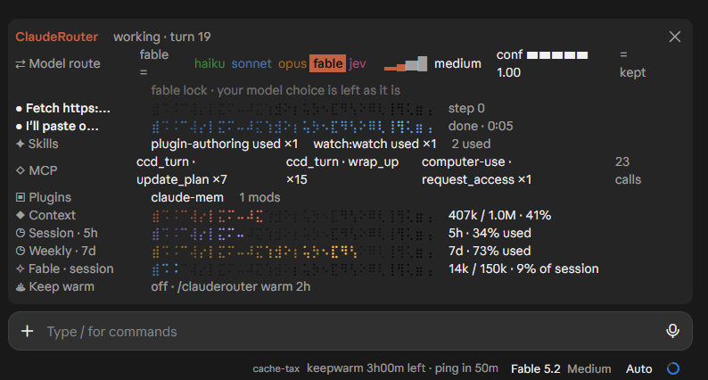

# ClaudeRouter

A Claude Code mod that picks the **model and effort for each request**, and keeps a live band above your prompt showing what the session is doing.



## What it does

- **Routes every request** to `haiku`, `sonnet` or `opus` with a reasoning effort (`low` → `xhigh`) and a confidence score. Routing is local keyword/length/tool heuristics: no model is called to decide. A small hysteresis stops it flip-flopping between tiers.
- **Live band above the prompt**: current route, running agents, skills used, MCP calls, plugins seen, context window, and 5h / 7d plan usage.
- **`/clauderouter` pane**: cost, tokens and elapsed time cards, plus the running and finished subagents with the model and effort each one got.
- **Jev as the router (optional)**: let [Jev](https://typesafe.ai) (TypeSafe System One) pick the tier instead of the keyword rules. Falls back to the rules on any error or timeout.
- **Keep the cache warm (optional)**: pings the prompt cache every 50 minutes while you are idle, so a break does not cost a full re-write.
- **Pixel mascots** per subagent role: scout (Explore), planner (Plan), researcher, builder.

## Cost guards (v0.4)

Applied on every model request, after the router (or Jev) has picked. Defaults protect your plan; change them with `/clauderouter`.

| Guard | Default | Effect |
|---|---|---|
| Effort ceiling | `high` | `xhigh` is never picked automatically. `/clauderouter cap medium` to lower it. |
| Opus plans, Sonnet executes | first 2 requests | After that, or once the turn writes files / runs 6+ tools, the turn moves to Sonnet (medium). |
| Long spec | > 1200 chars | Opus never runs above medium on it. |
| Subagents | not Opus | Only `Plan` subagents may use Opus; all others capped at medium. |
| Turn budget | $3 per turn | Over it: Sonnet medium. Over 2×: Sonnet low. A toast tells you. `/clauderouter budget 5` or `off`. |
| Context cap | 150k tokens | Over it: Sonnet medium. Over 1.5×: Sonnet low. `/clauderouter ctx 200k` or `off`. |
| Your choice wins | none | `/clauderouter pin sonnet medium` applies from the **next request, even mid-turn**. `pin auto` releases it. Or prefix one prompt: `@sonnet:med build the app` / `@opus:high ...`. |
| Model locks | `fable` | A session on a locked model is left alone, subagents included. See **Model locks**. |

The band's second line shows `guard ...` with the reason whenever a limit changed the pick. Budget uses the session cost the engine reports (API-equivalent USD).

## Model locks (v0.4.1)

A lock tells the router to leave a model alone. When the session runs on a locked model, every request keeps the model and effort it arrived with: no rerouting, no budget or context downgrade. The band shows `<model> lock`. Fable is locked by default; the router never picks Fable by itself.

- `/clauderouter lock opus` locks a model, `/clauderouter unlock opus` releases it. `lock all` / `lock none` for every model. `/clauderouter status` lists what is locked.
- **Subagents stay locked too.** A subagent spawned from a locked session that names no model inherits the session's model and keeps it on every request, until you unlock. A subagent whose Agent call names a model always keeps that model.
- A model id the router does not know is never rewritten (it used to become Sonnet).
- A pin (`/clauderouter pin <model>`) or an `@model` prompt prefix still wins over a lock.
- `/clauderouter fable lock` and `fable auto` from 0.4.1 still work; they mean `lock fable` and `unlock fable`.
- **What went wrong before:** the router only knew haiku, sonnet and opus. A Fable id matched none of them, so each request, main thread and subagents alike, was rewritten to `claude-sonnet-5-5` or `claude-haiku-5-5`, and the band said "switched". Ids are now looked up in `MODEL_IDS` instead of swapping a word in the running id.

## Dashboard pane (v0.4.2)

The full dashboard is the `/clauderouter` pane: cost, tokens and time, skills, MCP, plugins, context, 5h / 7d usage, the **Keep warm** clock (time left in the window and the countdown to the next ping), and the running and finished agents. It opens at session start, 24 rows tall. Drag or resize it with the engine's pane controls, or dock it beside the chat on a wide terminal, so it does not cover the conversation. The band above the prompt shows every row again (route, agents, skills, MCP, plugins, context, 5h / 7d, keep-warm). Claude Code places and sizes that band, so a mod cannot make it draggable; only the pane drags. To keep the chat clear, `/clauderouter band route` shrinks the band to the **task bar** (● task name, a bar with a `Tasks 2/4` pill, the percent, a small crab and the agent count) over the model route line, and `/clauderouter band full` brings every row back. Claude Code's own collapse (`[-]`, ctrl+x ctrl+a) also works on it.

**Bars show real values and never move.** Every bar is one text line tall, like the Savvy Progress reference, and holds a 4-row dot matrix: each cell is a braille character (a 2 x 4 grid of dots) with a fixed random subset lit, the same texture on every bar. The filled part shows it in the accent, the part still ahead shows the same dots very dim, so a fill reads as the texture being revealed. The terminal draws it as a one-row Raster, the desktop as Text runs. The fill is the measured share: context, 5h and 7d are their percent; a task is its finished subagents over all of them; a pane row is its share of the session's tokens. No reading yet means an all-dim bar. Opacity is eased, not linear: the fill is dim at its tail and brightens toward the leading edge on a power curve, and the track ahead fades out on a smoothstep. The `Tasks 2/4` capsule sits at the edge of the fill (left at 0%, moving right as it grows). The Jev chip is pink. The small crab beside the percent is the reference crab (eyes, side arms, four legs): a Raster in the terminal, a one-line block glyph on the desktop.

## Models (v0.4.2)

| Family | Id the router uses | Auto-picked | Notes |
|---|---|---|---|
| `haiku` | `claude-haiku-5-5` | yes | Light reads, searches, subagents of type Explore. |
| `sonnet` | `claude-sonnet-5-5` | yes | Default for building and executing. |
| `opus` | `claude-opus-5-5` | yes | Planning only (see cost guards). |
| `fable` | `claude-fable-5-2` | never | Locked by default. A session already on Fable 5.1 or 5 keeps its own id; `claude-fable-5-2` is only used when you pin or switch into Fable. |

**Fable and your plan** (per [Anthropic's help page](https://support.claude.com/en/articles/15424964-claude-fable-models-on-your-plan), checked 2026-11-09): Fable 5, 5.1 and 5.2 are on all paid plans. Max, Ultra and premium Team/Enterprise seats include Fable in the plan, up to 50% of the weekly limit; Pro and standard seats run Fable on usage credits. The page gives no end date for the plan inclusion; the one dated promotion (Fable 5 only) ended 2026-07-19. Claude Code minimums: Fable 5.2 needs 2.1.321, 5.1 needs 2.1.255. That is why Fable stays locked and is never picked automatically: it eats the weekly limit faster than the other models.

## Claude desktop

The mod is surface-aware: the band and pane already draw with plain `Text` bars on `desktop` (no Raster), and the tests cover both surfaces. Claude desktop's Code tab runs the same Claude Code engine, so install it there with the same two commands:

```
/plugin marketplace add C:\Users\studi.REAL\Documents\GitHub\ClaudeRouter
/plugin install agent-ClaudeRouter@router-mods
/reload-plugins
```

Install at user scope so the CLI and the desktop Code tab share it. Chat and Cowork tabs do not run mods.

## Requirements

- A Claude Code build that supports mods (plugins that ship `hooks/*.ts` modules and a `types` entry).
- Git, to clone the repo.

## Install

1. Clone the repo anywhere on your machine:

   ```bash
   git clone https://github.com/visualife/ClaudeRouter
   ```

2. In Claude Code, add the clone as a local marketplace and install the plugin:

   ```
   /plugin marketplace add ./ClaudeRouter
   /plugin install agent-ClaudeRouter@router-mods
   ```

   Use the full path to the clone if it is not in the directory you launched Claude Code from.

3. Reload plugins (`/reload-plugins`) or restart Claude Code. The band appears above the prompt.

## Usage

- **Band**: shows automatically. It updates on every prompt with the picked model, effort and confidence, and tells you when it switched model.
- **Pane**: type `/clauderouter` to open it. Press `Esc` to close.
- **Subagents**: each one appears in the pane's *Running* and *Finished* lists with its own model and effort.

## Options

Set them from the prompt; they persist across reloads.

| Command | Effect |
|---|---|
| `/clauderouter engine jev` | Jev picks haiku / sonnet / opus. Needs `TYPESAFE_API_KEY` in the environment. |
| `/clauderouter engine rules` | Local keyword rules (default). |
| `/clauderouter warm 2h` | Keep the prompt cache warm for 2h (default 2h, max 6h). |
| `/clauderouter warm off` | Stop. |
| `/clauderouter pin <model> [effort]` / `pin auto` | Force a model (and effort), effective next request. |
| `/clauderouter lock <model\|all\|none>` / `unlock <model\|all>` | Leave a model alone (no rerouting, no caps), subagents included. Fable is locked by default. |
| `/clauderouter cap <effort>` | Highest effort the router may pick. |
| `/clauderouter budget <usd\|off>` | Per-turn spend limit. |
| `/clauderouter ctx <150k\|off>` | Context size limit. |
| `/clauderouter band <full\|route>` | Band above the prompt: every row, or only the task bar and the model route. |
| `/clauderouter status` | Show the current options. |

**Jev**: it only chooses the tier; Claude still does the work. Each routed request sends the prompt text (first 4000 characters) to `api.typesafe.ai` and costs one small Jev call (about 0.3 s). In the band, `jev` sits beside `haiku sonnet opus` on the Model route row: lit when Jev made the pick, dim when the rules did. Once Jev has been used, a `Jev · context` bar appears: the last call's input tokens against Jev's 64k per-request window, with the call count. A Jev pick also starts the band's second line with `jev ·`. With no key, an error or a 2.5 s timeout, the rules decide, so nothing blocks.

**Keep warm**: each ping is a short model call on the existing conversation (cache reads, cheap). It only runs while the window is open and no turn is running, and it ends the window if a ping fails, since the cache is then probably gone. Switching model tiers loses the cache of the previous tier, which is what this is for. If you already run the `cache-tax` mod's `/keepwarm`, use one of the two, not both.

## Update / uninstall

```bash
git -C ClaudeRouter pull
```

```
/plugin uninstall agent-ClaudeRouter@router-mods
/plugin marketplace remove router-mods
```

## Tuning

Routing lives in `hooks/route.ts`: edit the `HEAVY`, `MID` and `LIGHT` keyword lists, or `HYSTERESIS`, to change how eagerly it moves between tiers.

## Layout

| Path | Role |
|---|---|
| `hooks/register.ts` | Hook and command registration, state, `/clauderouter` |
| `hooks/route.ts` | Model and effort heuristics |
| `hooks/guard.ts` | Cost guards: effort ceiling, plan/execute split, budget, context cap, pin |
| `hooks/band.ts` | The band above the prompt |
| `hooks/pane.ts` | The `/clauderouter` pane |
| `hooks/pixel.ts`, `format.ts`, `lists.ts` | Sprites, formatting, list rows |
| `tests/router.test.ts` | Routing tests |

## Notes

- Built against the Claude Code mod API; type stubs are generated into `.claude-plugin/types/` (git-ignored).
- Routing is a heuristic. Check the log of what it picked before trusting it on a real task.
